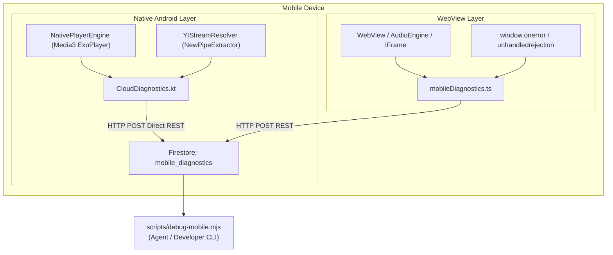

# Dotify Mobile Debugging & Remote Diagnostics Guide

Dotify features an automated, zero-guesswork remote error telemetry system that captures and ships live diagnostics from Android phones directly to Firebase Firestore (`dotify-11e01/mobile_diagnostics`).

---

## 1. Quick-Start Diagnostic CLI Commands

Run these terminal commands from the workspace root (`c:\Users\monty\Documents\AB\notify`):

```bash
# View the latest 10 error events from mobile devices:
node scripts/debug-mobile.mjs

# Or via npm shortcut:
npm run logs:mobile

# Live-tail errors in real-time (polls Firestore every 3s as the user uses the phone):
npm run logs:mobile:tail

# View last 50 diagnostic events:
node scripts/debug-mobile.mjs --limit 50

# Clear stored diagnostic logs:
node scripts/debug-mobile.mjs --clear
```

---

## 2. Telemetry Architecture

Dotify mobile captures diagnostic data across **two complementary layers**:



1. **Native Android Layer (`CloudDiagnostics.kt`)**:
   - Executes off the main thread via standard `HttpURLConnection`.
   - Ships events even if the device screen is off, in Android Doze mode, or if the WebView has been destroyed/backgrounded.
2. **WebView Frontend Layer (`mobileDiagnostics.ts`)**:
   - Catches JavaScript exceptions, unhandled Promise rejections, and audio engine fallback transitions.
   - Attaches detailed userAgent, device hardware model, track metadata, and stack traces.

---

## 3. Diagnostic Event Schema

Every document in Firestore `mobile_diagnostics` contains:

| Field | Type | Description |
| :--- | :--- | :--- |
| `timestamp` | `integer` | Epoch millisecond timestamp of the event |
| `isoTime` | `string` | ISO 8601 UTC timestamp (`2026-10-21T11:45:00.000Z`) |
| `level` | `string` | `'error'`, `'warn'`, or `'info'` |
| `category` | `string` | Diagnostic category (see Section 4) |
| `message` | `string` | Descriptive error message or exception summary |
| `appVersion` | `string` | App version installed on phone (e.g. `1.0.51`) |
| `platform` | `string` | `'Android'` or `'Desktop'` |
| `deviceModel` | `string` | Manufacturer and model (e.g. `Samsung SM-G998B (SDK 34)`) |
| `trackTitle` | `string` | Title of the track involved (if applicable) |
| `trackArtist` | `string` | Artist of the track involved |
| `trackId` | `string` | Unique Dotify track identifier |
| `videoId` | `string` | YouTube video ID being extracted or played |
| `resolveError`| `string` | Raw exception or resolver trace (e.g. `Extractor(vid): ParsingException`) |
| `details` | `map` | Auxiliary context (payloadIndex, queue state, error codes) |
| `stack` | `string` | JavaScript or native stack trace (if available) |

---

## 4. Common Diagnostic Categories & Triage Runbook

### A. `RESOLVE_FAILED` (Extraction & Parsing Failures)
- **Symptoms**: `YtStreamResolver` cannot extract a direct `.googlevideo.com` audio stream URL.
- **Common Traces**:
  - `Extractor(id): ParsingException: Could not parse response`: YouTube updated its HTML structure or player format for a specific music video.
  - `Extractor(id): ExtractionException: ...`: Signature cipher or age restriction.
- **Resolution Strategy**:
  - `YtStreamResolver.kt` automatically evaluates top 3 candidate IDs from web scraper search (often candidate #2 or #3 is a clean audio topic or lyric upload without complex signatures).
  - If native extraction fails completely, `audioEngine.ts` immediately activates `YouTubeIframeBridge`, allowing the WebView to play the track via YouTube's official player embed without stalling.

### B. `EXOPLAYER_ERROR` (Decoder & Network Failures)
- **Symptoms**: Media3 ExoPlayer throws `PlaybackException`.
- **Common Traces**:
  - `ERROR_CODE_IO_BAD_HTTP_STATUS (403)`: Stream URL expired or signature token rejected.
  - `ERROR_CODE_DECODER_INIT_FAILED`: Unsupported audio codec.
- **Resolution Strategy**:
  - ExoPlayer automatically re-resolves the track with `forceRefresh = true` to bypass cache.
  - If re-resolution fails, it tests the direct `streamUrl` fallback.
  - Non-active queued tracks are skipped without stopping the currently playing song (`firstAppend` guard).

### C. `IFRAME_ERROR` (Bridge Fallback Failures)
- **Symptoms**: `YouTubeIframeBridge` encounters player error 150/101 (embed restricted) or timeout.
- **Resolution Strategy**:
  - Verify `resolveYouTubeVideoId` returns a playable candidate.
  - Check whether video is embeddable on mobile.

### D. `UNCAUGHT_JS` (WebView Runtime Crashes)
- **Symptoms**: Unhandled exception in React components or background sync workers.
- **Resolution Strategy**:
  - Inspect the `stack` property in `debug-mobile.mjs` to locate the exact file and line number.

---

## 5. Mobile Invariants

1. **Queue Isolation Invariant**:
   - A resolution failure on a queued/subsequent track (`payloadIdx != currentIndex`) must **NEVER** emit a fatal `error` event that stops the active playing track.
   - Queued failures are logged as `level: warn` and skipped silently.
2. **User-Facing Toast Invariant**:
   - Raw developer stack traces (such as `Extractor(...): ParsingException: ...`) must never be displayed in Android Toasts.
3. **Dual-Layer Auto-Fallback Invariant**:
   - Any fatal native playback error on mobile must seamlessly hand off to `YouTubeIframeBridge` so music playback never terminates unexpectedly.
