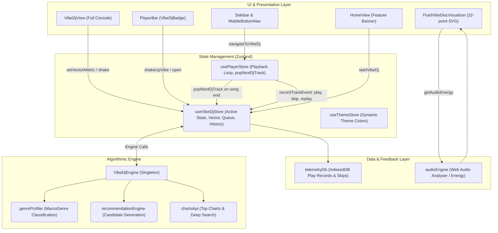
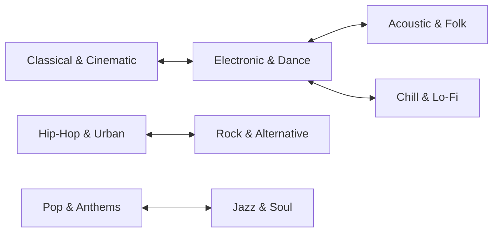

# Dotify Vibe DJ — Architecture & Functionality Specification

> **Feature Status**: Production-Ready / Active  
> **Brand Identity**: *Live AI DJ • Vibe*  
> **Core Module**: `src/services/vibeDjEngine.ts`, `src/store/vibeDjStore.ts`, `src/components/views/VibeDjView.tsx`  
> **Document Scope**: Full algorithmic, mathematical, state, telemetry, and UI mapping of the DJ system.

---

## 1. System Overview & Philosophy

**Vibe DJ** is Dotify's real-time, non-intrusive algorithmic DJ. Unlike intrusive voice-commentary DJs that interrupt songs with synthetic speech, Vibe DJ functions as an **adaptive musical selector and flow curator**:

1. **Continuously Learns From Listening Behavior**: Rather than relying solely on static playlists, it updates a multidimensional mathematical vector in real time based on track completion rates, skips, replays, and likes.
2. **Seamless Autonomous Playback**: When the active queue empties or finishes a song, the DJ autonomously scores, selects, and queues up the next optimal track without user intervention.
3. **Instant Pivots ("Shake Up the Vibe")**: Allows users to immediately break out of an acoustic rut by rotating the vibe vector at least two graph hops away in genre space and queuing a fresh contrasting soundscape.
4. **Interactive Steering**: Direct user tactile control through four acoustic parameter sliders (Energy, Dance, Mood, Acoustic) that dynamically re-bias upcoming recommendations with debounced re-scoring.
5. **Visual Audio-Reactive Identity**: Represented throughout the interface by the **Three-Tone Fluid Disc Visualizer**, undulating in real time to the music's frequency spectrum.

---

## 2. High-Level Architecture Diagram



---

## 3. Mathematical Model & The Vibe Vector

At the heart of the DJ is the **`VibeVector`**, an 8-dimensional normalized continuous vector space representing the listener's instant sonic state:

$$\mathbf{V} = \langle E, D, M, A, T, F, \mathbf{W}_{\text{genre}} \rangle$$

### Dimension Reference (`src/types/vibeDj.ts`)

| Dimension | Type / Range | Semantics |
| :--- | :--- | :--- |
| **`energy`** | `number` ($0.0 \dots 1.0$) | $0.0$ (ambient/sleep) to $1.0$ (hardstyle/heavy metal/hyper energy) |
| **`danceability`** | `number` ($0.0 \dots 1.0$) | $0.0$ (freeform/ambient/classical) to $1.0$ (four-on-the-floor dance) |
| **`mood`** | `number` ($0.0 \dots 1.0$) | $0.0$ (melancholic/dark/introspective) to $1.0$ (euphoric/sunny/celebratory) |
| **`acousticness`** | `number` ($0.0 \dots 1.0$) | $0.0$ (pure electronic/synthesizers) to $1.0$ (pure acoustic/unplugged/organic) |
| **`tempoNormalized`**| `number` ($0.0 \dots 1.0$) | $0.0$ ($\sim 60\text{ BPM}$) to $1.0$ ($\sim 180\text{ BPM}$) |
| **`familiarity`** | `number` ($0.0 \dots 1.0$) | $0.0$ (pure underground discovery) to $1.0$ (heavy rotation favorite) |
| **`genreWeights`** | `Record<MacroGenre, number>` | Normalized probability distribution over 8 macro-genres ($\sum W_g = 1.0$) |

### The 8 Macro-Genres
1. `Electronic & Dance`
2. `Hip-Hop & Urban`
3. `Rock & Alternative`
4. `Pop & Anthems`
5. `Chill & Lo-Fi`
6. `Acoustic & Folk`
7. `Jazz & Soul`
8. `Classical & Cinematic`

---

## 4. Genre Soundscapes & Dynamic Visual Themes

The active vibe vector dynamically drives the visual aesthetic of the DJ console and player bar. The dominant macro-genre resolves to one of eight custom soundscape themes:

| Macro-Genre | Soundscape Label | Tagline | Theme Color | Accent Hex |
| :--- | :--- | :--- | :--- | :--- |
| **Electronic & Dance** | Neon Cyber Circuit | *Driving synthesizers, rhythmic kinetic drops, and high-adrenaline momentum* | `purple` | `#a855f7` |
| **Hip-Hop & Urban** | Urban Bassline Flow | *Crisp boom-bap cadences, heavyweight 808s, and lyrical groove* | `amber` | `#f59e0b` |
| **Rock & Alternative** | Electric Velocity | *Raw overdrive guitars, driving anthems, and visceral acoustic presence* | `rose` | `#f43f5e` |
| **Pop & Anthems** | Prismatic Euphoria | *Soaring singalong hooks, radiant festival energy, and uplifting rhythms* | `rose` | `#fb7185` |
| **Chill & Lo-Fi** | Velvet Midnight Reverie | *Mellow vinyl crackle, tape-warm Rhodes chords, and restorative stillness* | `blue` | `#38bdf8` |
| **Acoustic & Folk** | Sunlit Timber & Soul | *Organic fingerpicked melodies, intimate harmonies, and timeless storytelling* | `emerald` | `#10b981` |
| **Jazz & Soul** | Smoky Groove Lounge | *Warm brass textures, syncopated upright bass, and velvet vocal warmth* | `amber` | `#d97706` |
| **Classical & Cinematic**| Symphonic Infinity | *Expansive orchestral swells, contemplative piano, and cinematic grandeur* | `purple` | `#818cf8` |

> **Energy Modifiers**:
> - If `energy > 0.8`: Theme label appends `" (High Energy)"`.
> - If `energy < 0.35`: Theme label appends `" (Mellow Downtempo)"`.

---

## 5. Algorithmic Intelligence (`VibeDjEngine`)

### 5.1 Vector Calibration & Seeding
When Vibe DJ starts (`startVibeDj(seedTrack)`):
1. **Seed Track Mode**: If launched from a specific track or actively playing song, `computeTrackVibeVector(seedTrack)` extracts baseline dimensions.
2. **Telemetry Decay Mode**: If started cold without a current track, the engine reads the last 10 plays from `telemetryDb` and computes a recency-weighted centroid using an exponential decay weight:
   $$W_i = 1.2^i \quad (i = 0 \dots 9)$$
3. **Cold Start Fallback**: Warm electronic/pop default vector ($E=0.65, D=0.70, M=0.68, A=0.25$).

### 5.2 Per-Track Acoustic Feature Extraction
For any candidate track, `computeTrackVibeVector(track)` assigns base metrics based on its classified `MacroGenre` and tunes them using title/artist heuristic tokens:

- **High Momentum Tokens** (`remix`, `club`, `hard`, `bass`, `turbo`, `drill`):
  $$\Delta E = +0.15, \quad \Delta D = +0.10, \quad \Delta T = +0.12$$
- **Acoustic / Downtempo Tokens** (`slowed`, `acoustic`, `lofi`, `ambient`, `sleep`, `chill`, `unplugged`, `piano`):
  $$\Delta E = -0.25, \quad \Delta A = +0.30, \quad \Delta T = -0.20$$
- **Euphoric Tokens** (`happy`, `party`, `summer`, `sun`, `love`, `euphoria`):
  $$\Delta M = +0.18$$
- **Melancholic Tokens** (`sad`, `dark`, `cry`, `lonely`, `night`, `shadow`):
  $$\Delta M = -0.20$$

### 5.3 Candidate Recommendation Pool Generation
To build the upcoming pool (`generateNextDjQueue`), the engine aggregates up to 100+ candidates across four distinct tiers:
1. **Top Charts**: Deezer / Chart API trending tracks.
2. **Made For You Shelves**: Candidates generated by `recommendationEngine` based on user listening clusters.
3. **Library Assets**: User's liked tracks and custom playlist items.
4. **Targeted Deep Genre Queries**: High-recall API queries for the dominant macro-genre (`searchCharts(dominant, 20)`).

### 5.4 Candidate Scoring Formula (0 to 100)
Each candidate track is evaluated against the current session vector through a **6-Factor Composite Scoring Model**:

$$\text{Score} = \text{round}\left( 42 \cdot S_{\text{vibe}} + 22 \cdot S_{\text{taste}} + 12 \cdot S_{\text{novelty}} + 12 \cdot S_{\text{diversity}} + 8 \cdot S_{\text{smoothing}} + 100 \cdot S_{\text{serendipity}} \right)$$

Clamped between $38$ and $99$.

```
┌────────────────────────────────────────────────────────────────────────┐
│                        6-FACTOR SCORING WEIGHTS                        │
├────────────────────────────────┬─────────┬─────────────────────────────┤
│ Component                      │ Weight  │ Description                 │
├────────────────────────────────┼─────────┼─────────────────────────────┤
│ 1. Vibe Alignment              │ 42%     │ Cosine & dot-product match  │
│ 2. Taste Affinity              │ 22%     │ User likes & followed stars │
│ 3. Novelty Lift                │ 12%     │ Fresh discovery reward      │
│ 4. Artist Diversity            │ 12%     │ Anti-clumping penalty       │
│ 5. Energy Smoothing            │  8%     │ Jump-prevention from last   │
│ 6. Serendipity & Pacing        │ ±7%     │ Hash & duration variance    │
└────────────────────────────────┴─────────┴─────────────────────────────┘
```

#### Factor Breakdown:
1. **Vibe Alignment ($S_{\text{vibe}}$)**:
   $$\text{AcousticDist} = 0.35 |E_s - E_t| + 0.25 |A_s - A_t| + 0.20 |M_s - M_t| + 0.20 |D_s - D_t|$$
   $$\text{AcousticSim} = 1.0 - \text{AcousticDist}$$
   $$\text{GenreDot} = \sum_{g} W_{s,g} \cdot W_{t,g}$$
   $$S_{\text{vibe}} = 0.5 \cdot \text{AcousticSim} + 0.5 \cdot \text{GenreDot}$$

2. **Taste Affinity ($S_{\text{taste}}$)**:
   $$\text{Base} = 0.5 \quad (+0.35 \text{ if in Liked Songs}) \quad (+0.30 \text{ if Artist Followed})$$

3. **Novelty Bonus ($S_{\text{novelty}}$)**:
   $$S_{\text{novelty}} = \begin{cases} 0.20 & \text{if never played before} \\ 0.05 & \text{if in history} \end{cases}$$

4. **Artist Diversity ($S_{\text{diversity}}$)**:
   Prevents repetitive artist clustering:
   - If artist played in the last 3 songs: $S_{\text{diversity}} = 0.15$ (heavy penalty).
   - If artist played in the last 6 songs: $S_{\text{diversity}} = 0.55$.
   - Otherwise: $S_{\text{diversity}} = 1.0$.

5. **Energy Smoothing ($S_{\text{smoothing}}$)**:
   Avoids abrupt tempo/energy whiplash from the immediately preceding track:
   $$\Delta E = |E_{\text{last}} - E_{\text{candidate}}|$$
   $$S_{\text{smoothing}} = \begin{cases} 1.0 & \text{if } \Delta E \le 0.45 \\ \max(0.3, 1.0 - (\Delta E - 0.45) \cdot 1.5) & \text{if } \Delta E > 0.45 \end{cases}$$

6. **Serendipity & Pacing ($S_{\text{serendipity}}$)**:
   Derived from a deterministic 32-bit Murmur-style bit-shift hash of `trackId:title:artist` normalized to $\pm 7\%$, combined with duration-based tempo heuristic (tracks $< 190\text{s}$ get punchiness bonus $+0.04$; tracks $> 320\text{s}$ get depth modifier $-0.04$).

### 5.5 Anti-Clumping Selection Filter
The ranked candidate list is filtered such that **no artist appears more than once** in the top DJ queue.

### 5.6 Explainable AI Reasons (`vibeReason`)
Every recommended track is stamped with an explicit, human-readable rationale:
- *"By [Artist] (one of your followed artists)"*
- *"Beloved track from your collection matching this vibe"*
- *"High-energy momentum booster matching your tempo"*
- *"Organic acoustic warmth complementing your flow"*
- *"Kinetic rhythm and driving groove pick"*
- *"Restorative downtime texture for contemplative listening"*
- *"Harmonically aligned with your active mood"*
- *"Fresh underground discovery tailored to your taste"*
- *"Crossover pick providing sonic contrast"*

---

## 6. Real-Time Dynamic Feedback Loop

The DJ reacts continuously to listener behavior through `recordTrackEvent` in `vibeDjStore.ts`:

```
               ┌────────────────────────────────────────────────────────┐
               │                  User Audio Playback                   │
               └──────────────────────────┬─────────────────────────────┘
                                          │
                  ┌───────────────────────┴───────────────────────┐
                  ▼                                               ▼
         [Song Completed / Vibed]                         [Track Skipped Early]
         (Completion rate ≥ 35%)                         (Completion < 35% & < 35s)
                  │                                               │
                  ▼                                               ▼
    Positive Reinforcement Learning               Course-Correction Repulsion
    - Learning rate: 0.22 (0.40 if replayed)      - Penalty factor: 0.35 * (1 - compRate)
    - Vectors pulled towards track metrics        - Vector pushed AWAY from skipped metrics
    - Genre weights incremented                   - Skipped genre weight reduced by 0.20
                  │                                               │
                  ▼                                               ▼
     Session History Appended                        Immediate Queue Regeneration
   ("Vibed" / "Replayed" Badge)                    (Purges tracks matching skipped vibe)
```

### Detailed Mechanics:
1. **Positive Reinforcement**:
   $$\text{rate} = (\text{replayed} \lor \text{liked} \ ? \ 0.40 : 0.22) \cdot \max(0.4, \text{completionRate})$$
   $$\mathbf{V}_{\text{new}} = \mathbf{V}_{\text{curr}} + (\mathbf{V}_{\text{track}} - \mathbf{V}_{\text{curr}}) \cdot \text{rate}$$

2. **Negative Course-Correction (Skip Repulsion)**:
   If a user skips before $35\%$ or $35\text{ seconds}$:
   $$\text{penalty} = 0.35 \cdot \max(0.5, 1.0 - \text{completionRate})$$
   $$\Delta E = E_{\text{track}} - E_{\text{curr}} \implies E_{\text{new}} = E_{\text{curr}} - \Delta E \cdot \text{penalty}$$
   $$\Delta A = A_{\text{track}} - A_{\text{curr}} \implies A_{\text{new}} = A_{\text{curr}} - \Delta A \cdot \text{penalty}$$
   The skipped track's genre weight is slashed by $0.20$, and `refreshRecommendations()` is immediately executed in the background to purge the remaining queue of similar tracks.

3. **Manual Steer-Away**:
   In `VibeDjView` under "Session Flow", each history track includes a **Thumbs-Down button** (`steerAwayFromTrack`). Clicking it treats the track as an immediate 10% skip, updates the vector, and replenishes the queue away from that sound.

---

## 7. "Shake Up the Vibe" Mechanism

When the user wants an exciting shift, they can trigger "Shake Up the Vibe":
- **Trigger Points**:
  1. Primary hero button in `VibeDjView`.
  2. Right-click or long-press on `VibeDjBadge` in the `PlayerBar`.

### Contrast Rotation Logic (`shakeUpVibe`):
The engine enforces a **minimum 2-hop topological genre distance** using a deterministic `CONTRAST_MAP`:



1. **Target Selection**: Selects a contrasting macro-genre at least 2 hops away.
2. **Mood Inversion**: Flips emotional valence:
   $$M_{\text{new}} = \begin{cases} 0.35 & \text{if } M_{\text{curr}} > 0.50 \\ 0.80 & \text{if } M_{\text{curr}} \le 0.50 \end{cases}$$
3. **Acoustic Restructuring**: Rebuilds energy, danceability, and acousticness to match the new territory ($80\%$ target genre weight).
4. **Shift Counter**: Increments `shakeCount` (e.g. `(Shift #3)`).
5. **Immediate Queue Drop**: Automatically starts playing track #1 of the new vibe.

---

## 8. Contextual Artist Recommendations

`VibeDjView` features an **"Artists Matching This Vibe"** horizontal carousel displaying 4–6 contextual artist cards:

- **Scoring**: Ranks artists within the dominant macro-genre by library presence, follower status (+25 pts), and telemetry completion rates (+10 pts per full listen).
- **One-Click Deep Dive (`playRecommendedArtist`)**:
  1. Searches the artist's catalogue for top 15 tracks.
  2. Temporarily locks the vector's dominant genre weight ($75\%$) to that artist.
  3. Re-labels the session as `"[Artist Name] Flow"`.
  4. Begins playback immediately and replenishes the upcoming queue biased toward their sound.

---

## 9. Tactile Parameter Sliders

Four sliders in `VibeDjView` give users direct steering over their soundscape:

| Slider | Metric | Min | Max | Target Characteristic |
| :--- | :--- | :--- | :--- | :--- |
| **Energy** | `energy` | 10% | 95% | Intensity, tempo, loud kick vs ambient stillness |
| **Dance** | `danceability` | 10% | 95% | Rhythm regularity, four-on-the-floor beat vs freeform |
| **Mood** | `mood` | 10% | 95% | Melancholic/dark introspective vs euphoric/sunlit |
| **Acoustic** | `acousticness` | 10% | 95% | Synthesizers/electronic vs organic wood/strings |

- **Debounced Feedback (450ms)**: Dragging any slider instantly updates the UI percentage readout and color gradient. After 450ms of inactivity, `refreshRecommendations()` executes in the background to realign the upcoming queue without interrupting current playback.

---

## 10. PlayerStore Autonomous Playback Loop

The connection between the DJ and playback lives in `src/store/playerStore.ts`:

1. **Automatic Sequential Flow**:
   When a track ends or the user clicks "Next Track" (`nextTrack()`):
   ```typescript
   if (djState?.isActive) {
     const nextDjTrack = await djState.popNextDjTrack();
     if (nextDjTrack) {
       get().playTrack(nextDjTrack, undefined, undefined, {
         origin: 'vibe_dj',
         intent: 'exploratory',
         playlistName: djState.vibeLabel,
         isDj: true,
       });
       return;
     }
   }
   ```
2. **Buffer Replenishment**:
   When `popNextDjTrack()` leaves fewer than 4 tracks in `djQueue`, the store automatically calls `refreshRecommendations()` in the background.
3. **Emergency Refill**:
   If the queue reaches 0, `popNextDjTrack()` performs an emergency synchronous generation of 6 tracks.
4. **Non-Intrusive Invariant**:
   If the user manually plays a track from Search, an Album, or Liked Songs without `isDj: true`, the DJ gracefully deactivates (`stopVibeDj()`) and yields control to the user.

---

## 11. Visual Audio-Reactive Disc (`FluidVibeDiscVisualizer`)

The visual trademark of Vibe DJ is the **Three-Tone Fluid Disc Visualizer**:

- **Location**: `src/components/common/FluidVibeDiscVisualizer.tsx`
- **Architecture**:
  1. **Outer Perimeter**: 32 radial vertices calculating viscous fluid displacement from real-time Web Audio API energy (`audioEngine.getAudioEnergy()`).
  2. **Fallback Energy Synthesis**: In remote Google Cast, kitchen smart speakers, or YouTube iframe bridge mode where raw PCM is sandboxed, it automatically synthesizes a tempo-locked kick envelope ($124\text{ BPM}$).
  3. **Static Center Invariant**:
     - Outer Layer: User's dynamic app theme color (fluidly expanding and contracting).
     - Middle Ring: Solid neutral grey ring (100% static, centered at $(50,50)$).
     - Inner Dot: Pitch-black center dot (100% static, centered at $(50,50)$).

---

## 12. Component & File Reference Map

| Component / File | Location | Primary Responsibility |
| :--- | :--- | :--- |
| **`vibeDj.ts`** | `src/types/vibeDj.ts` | Data types: `VibeVector`, `VibeDjTrackRecommendation`, `VibeDjArtistRecommendation`, `VibeDjState` |
| **`vibes.ts`** | `src/types/vibes.ts` | Shared types: `MacroGenre`, `GenreGroupAffinity`, `UserTasteProfile` |
| **`vibeDjEngine.ts`** | `src/services/vibeDjEngine.ts` | Core mathematical engine: vector math, 6-factor scoring, shakeup contrast map, acoustic heuristics |
| **`vibeDjStore.ts`** | `src/store/vibeDjStore.ts` | Zustand state: active queue, real-time feedback loop, debounce timers, history |
| **`VibeDjView.tsx`** | `src/components/views/VibeDjView.tsx` | Full-screen console: spinning vinyl record, parameter sliders, upcoming flow, session audit log |
| **`VibeDjBadge.tsx`** | `src/components/player/VibeDjBadge.tsx` | Player bar trigger with fluid disc visualizer; left-click opens, right-click shakes |
| **`FluidVibeDiscVisualizer.tsx`**| `src/components/common/FluidVibeDiscVisualizer.tsx` | 32-point SVG liquid perimeter visualizer with Web Audio analyser bridge |
| **`playerStore.ts`** | `src/store/playerStore.ts` | Playback integration: `popNextDjTrack`, skip telemetry reporting, auto-refill triggers |
| **`HomeView.tsx`** | `src/components/views/HomeView.tsx` | Feature banner: "Endless Live Flow with Vibe DJ" with quick launch button |
| **`geminiVibeService.ts`** | `src/services/geminiVibeService.ts` | Complementary daily offline vibe playlists via Gemini 3.8 Flash & Google Search grounding |

---

## 13. Summary Matrix of User Interactions

```
┌───────────────────────────────┬───────────────────────────────┬───────────────────────────────────────────┐
│ User Action                   │ Trigger / Location            │ System Consequence                        │
├───────────────────────────────┼───────────────────────────────┼───────────────────────────────────────────┤
│ Start Vibe DJ                 │ Home banner or Sidebar        │ Calibrates vector from seed/telemetry;    │
│                               │                               │ populates 8 upcoming tracks and plays #1  │
├───────────────────────────────┼───────────────────────────────┼───────────────────────────────────────────┤
│ Shake Up the Vibe             │ "Shake" button or Badge click │ Rotates vector ≥2 hops away in genre space;│
│                               │                               │ inverts mood; plays fresh #1 track        │
├───────────────────────────────┼───────────────────────────────┼───────────────────────────────────────────┤
│ Adjust Parameter Slider       │ VibeDjView (Energy/Dance/etc) │ Instantly updates visual theme;           │
│                               │                               │ re-scores upcoming queue after 450ms      │
├───────────────────────────────┼───────────────────────────────┼───────────────────────────────────────────┤
│ Skip Track Early (<35s)       │ PlayerBar "Next" button       │ Triggers skip repulsion penalty;          │
│                               │                               │ immediately regenerates upcoming queue    │
├───────────────────────────────┼───────────────────────────────┼───────────────────────────────────────────┤
│ Listen Track to Completion    │ Natural song conclusion       │ Applies positive reinforcement learning;  │
│                               │                               │ automatically pops next track from flow   │
├───────────────────────────────┼───────────────────────────────┼───────────────────────────────────────────┤
│ Click Recommended Artist      │ "Artists Matching This Vibe"  │ Shifts dominant genre to artist;          │
│                               │                               │ plays top tracks in "[Artist] Flow"       │
├───────────────────────────────┼───────────────────────────────┼───────────────────────────────────────────┤
│ Steer Away (Thumbs Down)      │ Session Flow history item     │ Treats track as 10% skip;                 │
│                               │                               │ steers vector away and refreshes queue    │
├───────────────────────────────┼───────────────────────────────┼───────────────────────────────────────────┤
│ Play Outside Song             │ Search, Albums, Liked Songs   │ DJ automatically stops without conflict   │
└───────────────────────────────┴───────────────────────────────┴───────────────────────────────────────────┘
```

---

## 14. Complete Listening Telemetry & Data Recording Specification

Dotify incorporates a high-resolution, privacy-first **On-Device Listening Telemetry System**. All playback interactions, session durations, skips, replays, and musical affinities are recorded locally inside IndexedDB (`dotify_telemetry_db`) without external surveillance tracking.

### 14.1 IndexedDB Database Topology (`dotify_telemetry_db`)

The database runs on version `1` and maintains four core object stores (with dual alias compatibility for legacy consumers):

```
dotify_telemetry_db (v1)
├── listening_sessions (alias: sessions) [keyPath: sessionId]
│   └── index: startTime
├── track_plays (alias: plays)           [keyPath: playId]
│   ├── index: sessionId
│   ├── index: trackId
│   ├── index: artist
│   ├── index: genre
│   ├── index: startTime
│   ├── index: completionRate
│   └── index: completed
├── genre_affinity (alias: genreAffinities) [keyPath: genre]
│   ├── index: affinityScore
│   └── index: lastUpdated
└── artist_affinity (alias: artistAffinities) [keyPath: artist]
    ├── index: affinityScore
    └── index: lastUpdated
```

---

### 14.2 Detailed Field-by-Field Telemetry Schema

#### A. Track Play Record (`TrackPlayRecord` in `track_plays`)
Every time a track is played and finalized (when changing songs, completing, or skipping), an immutable play record is written:

| Field Name | Type | Unit / Range | Derivation & Semantics |
| :--- | :--- | :--- | :--- |
| `playId` | `string` | Unique ID | Format: `play_{timestamp}_{random5}` (e.g. `play_1730545200000_a8f9z`) |
| `sessionId` | `string` | Foreign Key | References active `listening_sessions.sessionId` |
| `trackId` | `string` | Unique ID | Upstream stream ID (e.g. `charts:123456`, `yt_dQw4w9WgXcQ`, `audius_...`) |
| `title` | `string` | Text | Clean track title |
| `artist` | `string` | Text | Primary artist name (stripped of featured artists) |
| `genre` | `string` | Text | Classified genre or macro-genre (or `'Unknown'`) |
| `source` | `TrackSource` | Enum | Origin feed: `'charts'`, `'audius'`, `'archive'`, `'radio'`, `'torrent'`, `'youtube'`, `'local'` |
| `startTime` | `number` | Unix ms | Timestamp when the user started listening to this track |
| `durationPlayedMs`| `number`| Milliseconds | **Active listening time**: Accumulated exclusively while playing. Pauses, buffers, and tab suspensions are frozen out |
| `totalDurationMs` | `number`| Milliseconds | Total expected song duration in ms |
| `completionRate` | `number` | $0.0 \dots 1.0$ | Exact fraction: $\min(1.0, \text{durationPlayedMs} / \text{totalDurationMs})$ |
| `completed` | `boolean`| Boolean | `true` if `completionRate >= 0.8` (listened to at least 80% of song) |
| `skipped` | `boolean`| Boolean | `true` if (`durationPlayedMs < 30000` or `completionRate < 0.5`) AND `completed === false` |
| `replayed` | `boolean`| Boolean | `true` if the user immediately restarted or re-cued the song |
| `userLiked` | `boolean`| Boolean | `true` if the track resides in the user's Liked Songs library |
| `artworkUrl` | `string` | URL | High-resolution cover art URL |
| `origin` | `PlayOrigin` | Enum (13 types)| Explicit origin channel where play was initiated (see Section 14.3) |
| `intent` | `PlayIntent` | Enum | `'favoured'` (high personal taste signal) vs `'exploratory'` (passive discovery) |
| `intentWeight` | `number` | $0.05 \dots 1.0$| $1.0$ for favoured, $0.05$ for skips, $0.15 \times \text{comp}$ for passive |
| `searchQuery` | `string?` | Text | If played from Search, the exact search string query entered |
| `contextMetadata` | `object` | JSON | Context metadata: `{ playlistId, playlistName, artistName, albumTitle }` |

#### B. Listening Session Record (`ListeningSessionRecord` in `listening_sessions`)
Groups sequential continuous plays into aggregate sessions:

| Field Name | Type | Semantics |
| :--- | :--- | :--- |
| `sessionId` | `string` | Format: `session_{timestamp}_{random5}` |
| `startTime` / `startedAt` | `number` | Unix timestamp ms when the session began |
| `endTime` / `endedAt` | `number` | Unix timestamp ms of last recorded play activity |
| `lastActiveAt` | `number` | Heartbeat timestamp of last playback update |
| `deviceType` | `DeviceType` | `'desktop'`, `'mobile'` (screen width $< 768\text{px}$), or `'web'` |
| `tracksPlayed` | `number` | Cumulative integer count of tracks queued and played in this session |
| `totalPlayTimeMs` | `number` | Cumulative milliseconds of actual audio rendered |
| `totalDurationMs` | `number` | Total duration of songs queued in session |

#### C. Genre Affinity Record (`GenreAffinityRecord` in `genre_affinity`)
Aggregated per distinct genre to build the user's continuous taste profile:

| Field Name | Type | Semantics |
| :--- | :--- | :--- |
| `genre` | `string` | Primary key (e.g. `'Synthpop'`, `'Electronic & Dance'`, `'Indie Rock'`) |
| `playCount` | `number` | Total number of times tracks in this genre were played |
| `favouredPlayCount`| `number` | Plays originating from explicit user intent (Search, Library, Liked, Replay) |
| `passivePlayCount` | `number` | Plays originating from passive discovery (DJ, Autoplay, Daily Mix) |
| `totalTimePlayedMs`| `number` | Cumulative listening time in milliseconds |
| `affinityScore` | `number` ($1 \dots 100$) | Algorithmic taste strength score (see formula below) |
| `lastUpdated` | `number` | Unix timestamp ms of most recent update |

#### D. Artist Affinity Record (`ArtistAffinityRecord` in `artist_affinity`)
Maintains per-artist loyalty metrics using the exact same schema and scoring formula as Genre Affinity, keyed by primary artist name.

---

### 14.3 Origin & Intent Classification (`listeningClassifier.ts`)

Dotify distinguishes between **Explicit Favour** (the user deliberately chose to hear this track) and **Passive / Exploratory Discovery** (the algorithm served the track).

#### The 13 Origin Channels (`PlayOrigin`):
1. `'search'` — User typed a query in the search bar and clicked the result.
2. `'artist'` — User clicked an artist profile, artist top hits, or artist discography.
3. `'song'` — User clicked directly on a specific track row.
4. `'library'` — User played from their Liked Songs collection.
5. `'user_playlist'` — User played from a custom created/imported playlist.
6. `'vibe_dj'` — Streamed sequentially via the Live AI Vibe DJ flow.
7. `'vibe_playlist'` — Played from a daily Gemini AI-curated playlist (Gaming, Chill, etc.).
8. `'discover_track'` — Played from a discovery shelf / echo break.
9. `'discover_weekly'` — Played from the algorithmic Discover Weekly shelf.
10. `'autoplay'` — Infinite playback continuation triggered when the queue ended.
11. `'radio'` — Artist radio or genre station stream.
12. `'recommendation'` — Played from Daily Mix, Heavy Rotation, or Forgotten Favorites.
13. `'charts'` — Played directly from the global trending Top Charts.

#### Intent Classification Rules:
- **`favoured` ($1.0$ weight)**: Explicit search clicks, direct artist profile hits, library/liked tracks, user custom playlists, and **any replayed track** (even if discovered on a vibe playlist).
- **`exploratory` ($0.05 \dots 0.25$ weight)**: Vibe DJ, Daily Mix, Autoplay, Radio, and Charts.
- **Skip penalty ($0.05$ weight)**: Any track abandoned before $30\text{ seconds}$ or $50\%$ completion.

---

### 14.4 Affinity Scoring Mathematics

For both genres and artists, the `affinityScore` ($1 \dots 100$) is calculated as:

$$\text{PlayFactor} = (\text{favouredPlays} \times 5) + (\text{passivePlays} \times 1)$$
$$\text{TimeMinutes} = \lfloor \text{totalTimePlayedMs} / 60000 \rfloor$$
$$\text{TimeFactor} = \text{favouredMinutes} + (\text{passiveMinutes} \times 0.3)$$
$$\text{DeltaBonus} = (\text{replayed} \ ? \ +15 : 0) + (\text{completed} \ ? \ +10 : 0) - (\text{skipped} \ ? \ 5 : 0)$$

$$\text{AffinityScore} = \text{clamp}\Big(1, 100, \text{round}(\text{PlayFactor} + \text{TimeFactor} + \text{DeltaBonus})\Big)$$

This ensures that an artist the user actively searches for and replays gains affinity $5\times$ faster than an artist played passively in the background.

---

### 14.5 Real-Time Duration Accumulator (`playerStore.ts`)

To prevent false telemetry from paused audio or backgrounded tabs, `playerStore.ts` implements a high-resolution accumulation loop:

```typescript
// Heartbeat tick loop running every ~100-200ms
if (activePlayRecord && get().isPlaying) {
  const now = performance.now();
  const delta = now - activePlayRecord.lastTick;
  if (delta > 0 && delta < 500) { // Discard clock jumps / tab suspensions
    activePlayRecord.durationPlayedMs += delta;
  }
  activePlayRecord.lastTick = now;
}
```

When track playback terminates (`finalizeCurrentPlayRecord`), the exact active duration is committed to `telemetryDb.recordPlay()`.

---

### 14.6 Community Listening & Cloud Telemetry

In addition to local IndexedDB storage:

1. **Community Listening Feed (`communityListeningService.ts`)**:
   - Condition: If a track is listened to for $\ge 15\text{ seconds}$ OR $\ge 40\%$ completion:
   - Writes to Firestore document `app_config/community_listening` and localStorage `dotify_community_recent_plays`:
     * `trackId`: unique ID
     * `title`: song title
     * `artist`: primary artist
     * `album`: album name
     * `artworkUrl`: verified album art
     * `timestamp`: Unix ms
     * `genre`: track genre
     * `userId`: user UID or `'guest'`
   - Powers global listener counts and community trending shelves.

2. **Mobile Remote Diagnostics (`mobileTelemetryService.ts`)**:
   - Stream playback failures, ExoPlayer decoder errors, and NewPipeExtractor parsing exceptions are pushed to Firestore `mobile_diagnostics` for real-time mobile debugging.

---

### 14.7 Exportable Telemetry Dataset Schema (`ExportableTelemetryDataset`)

Users can export their complete listening history into a structured, portable JSON dataset for backup or external recommendation modeling:

```typescript
export interface ExportableTelemetryDataset {
  schemaVersion: 1;
  version: 1;
  exportedAt: number | string; // Unix ms or ISO 8601
  sessions: ListeningSessionRecord[];
  plays: TrackPlayRecord[];
  genreAffinities: GenreAffinityRecord[];
  artistAffinities: ArtistAffinityRecord[];
}
```

