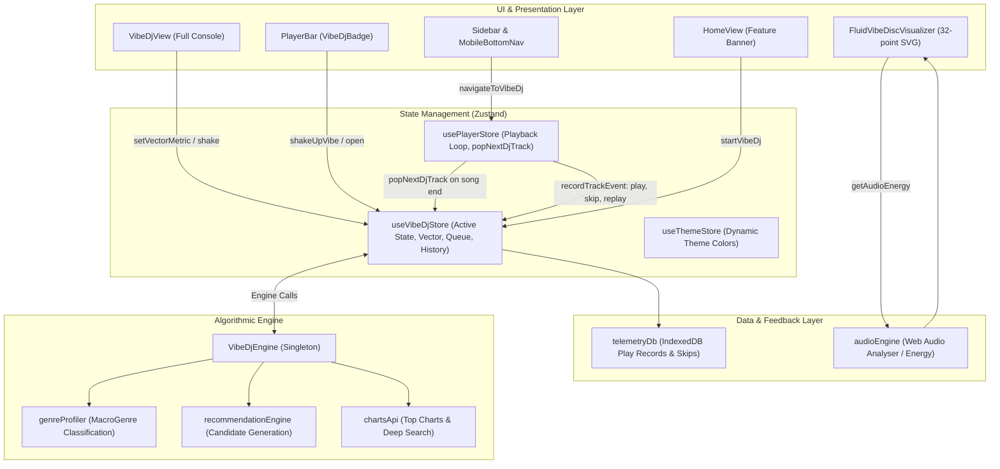
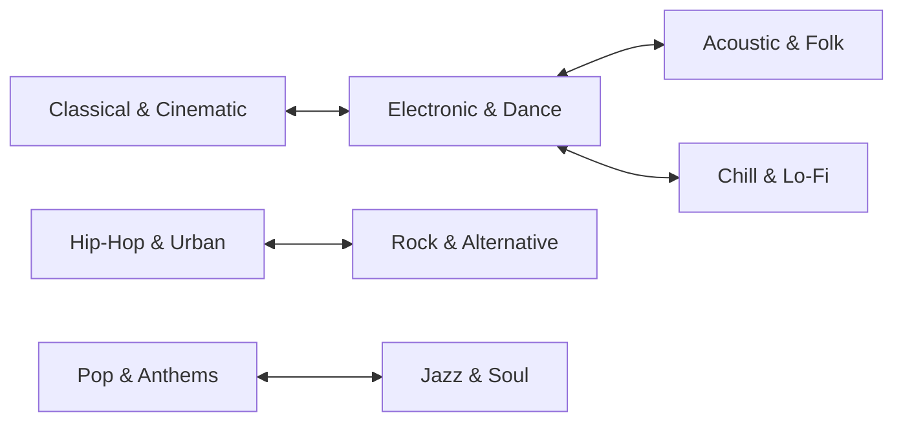
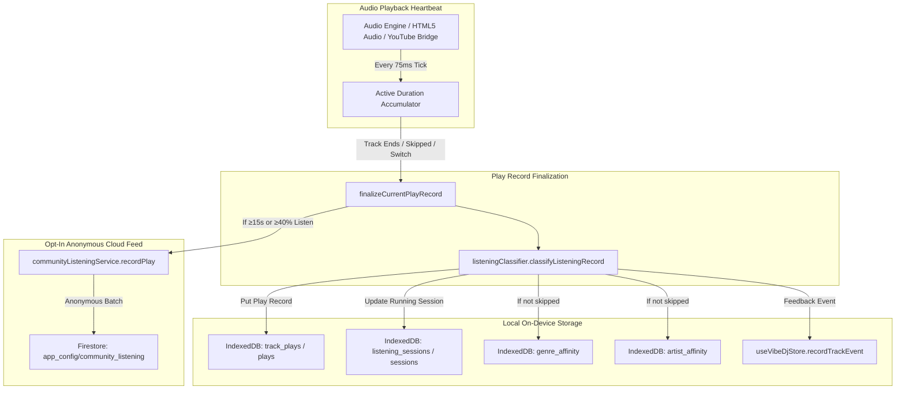

# Dotify Vibe DJ — Architecture & Functionality Specification

> **Feature Status**: Production-Ready / Active  
> **Brand Identity**: *Live AI DJ • Vibe*  
> **Core Module**: `src/services/vibeDjEngine.ts`, `src/store/vibeDjStore.ts`, `src/components/views/VibeDjView.tsx`  
> **Document Scope**: Full algorithmic, mathematical, state, telemetry, and UI mapping of the DJ system.

---

## 1. System Overview & Philosophy

**Vibe DJ** is Dotify's real-time, non-intrusive algorithmic DJ. Unlike intrusive voice-commentary DJs that interrupt songs with synthetic speech, Vibe DJ functions as an **adaptive musical selector and flow curator**:

1. **Continuously Learns From Listening Behavior**: Rather than relying solely on static playlists, it updates a multidimensional mathematical vector in real time based on track completion rates, skips, replays, and likes.
2. **Seamless Autonomous Playback**: When the active queue empties or finishes a song, the DJ autonomously scores, selects, and queues up the next optimal track without user intervention.
3. **Instant Pivots ("Shake Up the Vibe")**: Allows users to immediately break out of an acoustic rut by rotating the vibe vector at least two graph hops away in genre space and queuing a fresh contrasting soundscape.
4. **Interactive Steering**: Direct user tactile control through four acoustic parameter sliders (Energy, Dance, Mood, Acoustic) that dynamically re-bias upcoming recommendations with debounced re-scoring.
5. **Visual Audio-Reactive Identity**: Represented throughout the interface by the **Three-Tone Fluid Disc Visualizer**, undulating in real time to the music's frequency spectrum.

---

## 2. High-Level Architecture Diagram



---

## 3. Mathematical Model & The Vibe Vector

At the heart of the DJ is the **`VibeVector`**, an 8-dimensional normalized continuous vector space representing the listener's instant sonic state:

$$\mathbf{V} = \langle E, D, M, A, T, F, \mathbf{W}_{\text{genre}} \rangle$$

### Dimension Reference (`src/types/vibeDj.ts`)

| Dimension | Type / Range | Semantics |
| :--- | :--- | :--- |
| **`energy`** | `number` ($0.0 \dots 1.0$) | $0.0$ (ambient/sleep) to $1.0$ (hardstyle/heavy metal/hyper energy) |
| **`danceability`** | `number` ($0.0 \dots 1.0$) | $0.0$ (freeform/ambient/classical) to $1.0$ (four-on-the-floor dance) |
| **`mood`** | `number` ($0.0 \dots 1.0$) | $0.0$ (melancholic/dark/introspective) to $1.0$ (euphoric/sunny/celebratory) |
| **`acousticness`** | `number` ($0.0 \dots 1.0$) | $0.0$ (pure electronic/synthesizers) to $1.0$ (pure acoustic/unplugged/organic) |
| **`tempoNormalized`**| `number` ($0.0 \dots 1.0$) | $0.0$ ($\sim 60\text{ BPM}$) to $1.0$ ($\sim 180\text{ BPM}$) |
| **`familiarity`** | `number` ($0.0 \dots 1.0$) | $0.0$ (pure underground discovery) to $1.0$ (heavy rotation favorite) |
| **`genreWeights`** | `Record<MacroGenre, number>` | Normalized probability distribution over 8 macro-genres ($\sum W_g = 1.0$) |

### The 8 Macro-Genres
1. `Electronic & Dance`
2. `Hip-Hop & Urban`
3. `Rock & Alternative`
4. `Pop & Anthems`
5. `Chill & Lo-Fi`
6. `Acoustic & Folk`
7. `Jazz & Soul`
8. `Classical & Cinematic`

---

## 4. Genre Soundscapes & Dynamic Visual Themes

The active vibe vector dynamically drives the visual aesthetic of the DJ console and player bar. The dominant macro-genre resolves to one of eight custom soundscape themes:

| Macro-Genre | Soundscape Label | Tagline | Theme Color | Accent Hex |
| :--- | :--- | :--- | :--- | :--- |
| **Electronic & Dance** | Neon Cyber Circuit | *Driving synthesizers, rhythmic kinetic drops, and high-adrenaline momentum* | `purple` | `#a855f7` |
| **Hip-Hop & Urban** | Urban Bassline Flow | *Crisp boom-bap cadences, heavyweight 808s, and lyrical groove* | `amber` | `#f59e0b` |
| **Rock & Alternative** | Electric Velocity | *Raw overdrive guitars, driving anthems, and visceral acoustic presence* | `rose` | `#f43f5e` |
| **Pop & Anthems** | Prismatic Euphoria | *Soaring singalong hooks, radiant festival energy, and uplifting rhythms* | `rose` | `#fb7185` |
| **Chill & Lo-Fi** | Velvet Midnight Reverie | *Mellow vinyl crackle, tape-warm Rhodes chords, and restorative stillness* | `blue` | `#38bdf8` |
| **Acoustic & Folk** | Sunlit Timber & Soul | *Organic fingerpicked melodies, intimate harmonies, and timeless storytelling* | `emerald` | `#10b981` |
| **Jazz & Soul** | Smoky Groove Lounge | *Warm brass textures, syncopated upright bass, and velvet vocal warmth* | `amber` | `#d97706` |
| **Classical & Cinematic**| Symphonic Infinity | *Expansive orchestral swells, contemplative piano, and cinematic grandeur* | `purple` | `#818cf8` |

> **Energy Modifiers**:
> - If `energy > 0.8`: Theme label appends `" (High Energy)"`.
> - If `energy < 0.35`: Theme label appends `" (Mellow Downtempo)"`.

---

## 5. Algorithmic Intelligence (`VibeDjEngine`)

### 5.1 Vector Calibration & Seeding
When Vibe DJ starts (`startVibeDj(seedTrack)`):
1. **Seed Track Mode**: If launched from a specific track or actively playing song, `computeTrackVibeVector(seedTrack)` extracts baseline dimensions.
2. **Telemetry Decay Mode**: If started cold without a current track, the engine reads the last 10 plays from `telemetryDb` and computes a recency-weighted centroid using an exponential decay weight:
   $$W_i = 1.2^i \quad (i = 0 \dots 9)$$
3. **Cold Start Fallback**: Warm electronic/pop default vector ($E=0.65, D=0.70, M=0.68, A=0.25$).

### 5.2 Per-Track Acoustic Feature Extraction
For any candidate track, `computeTrackVibeVector(track)` assigns base metrics based on its classified `MacroGenre` and tunes them using title/artist heuristic tokens:

- **High Momentum Tokens** (`remix`, `club`, `hard`, `bass`, `turbo`, `drill`):
  $$\Delta E = +0.15, \quad \Delta D = +0.10, \quad \Delta T = +0.12$$
- **Acoustic / Downtempo Tokens** (`slowed`, `acoustic`, `lofi`, `ambient`, `sleep`, `chill`, `unplugged`, `piano`):
  $$\Delta E = -0.25, \quad \Delta A = +0.30, \quad \Delta T = -0.20$$
- **Euphoric Tokens** (`happy`, `party`, `summer`, `sun`, `love`, `euphoria`):
  $$\Delta M = +0.18$$
- **Melancholic Tokens** (`sad`, `dark`, `cry`, `lonely`, `night`, `shadow`):
  $$\Delta M = -0.20$$

### 5.3 Candidate Recommendation Pool Generation
To build the upcoming pool (`generateNextDjQueue`), the engine aggregates up to 100+ candidates across four distinct tiers:
1. **Top Charts**: Deezer / Chart API trending tracks.
2. **Made For You Shelves**: Candidates generated by `recommendationEngine` based on user listening clusters.
3. **Library Assets**: User's liked tracks and custom playlist items.
4. **Targeted Deep Genre Queries**: High-recall API queries for the dominant macro-genre (`searchCharts(dominant, 20)`).

### 5.4 Candidate Scoring Formula (0 to 100)
Each candidate track is evaluated against the current session vector through a **6-Factor Composite Scoring Model**:

$$\text{Score} = \text{round}\left( 42 \cdot S_{\text{vibe}} + 22 \cdot S_{\text{taste}} + 12 \cdot S_{\text{novelty}} + 12 \cdot S_{\text{diversity}} + 8 \cdot S_{\text{smoothing}} + 100 \cdot S_{\text{serendipity}} \right)$$

Clamped between $38$ and $99$.

```
┌────────────────────────────────────────────────────────────────────────┐
│                        6-FACTOR SCORING WEIGHTS                        │
├────────────────────────────────┬─────────┬─────────────────────────────┤
│ Component                      │ Weight  │ Description                 │
├────────────────────────────────┼─────────┼─────────────────────────────┤
│ 1. Vibe Alignment              │ 42%     │ Cosine & dot-product match  │
│ 2. Taste Affinity              │ 22%     │ User likes & followed stars │
│ 3. Novelty Lift                │ 12%     │ Fresh discovery reward      │
│ 4. Artist Diversity            │ 12%     │ Anti-clumping penalty       │
│ 5. Energy Smoothing            │  8%     │ Jump-prevention from last   │
│ 6. Serendipity & Pacing        │ ±7%     │ Hash & duration variance    │
└────────────────────────────────┴─────────┴─────────────────────────────┘
```

#### Factor Breakdown:
1. **Vibe Alignment ($S_{\text{vibe}}$)**:
   $$\text{AcousticDist} = 0.35 |E_s - E_t| + 0.25 |A_s - A_t| + 0.20 |M_s - M_t| + 0.20 |D_s - D_t|$$
   $$\text{AcousticSim} = 1.0 - \text{AcousticDist}$$
   $$\text{GenreDot} = \sum_{g} W_{s,g} \cdot W_{t,g}$$
   $$S_{\text{vibe}} = 0.5 \cdot \text{AcousticSim} + 0.5 \cdot \text{GenreDot}$$

2. **Taste Affinity ($S_{\text{taste}}$)**:
   $$\text{Base} = 0.5 \quad (+0.35 \text{ if in Liked Songs}) \quad (+0.30 \text{ if Artist Followed})$$

3. **Novelty Bonus ($S_{\text{novelty}}$)**:
   $$S_{\text{novelty}} = \begin{cases} 0.20 & \text{if never played before} \\ 0.05 & \text{if in history} \end{cases}$$

4. **Artist Diversity ($S_{\text{diversity}}$)**:
   Prevents repetitive artist clustering:
   - If artist played in the last 3 songs: $S_{\text{diversity}} = 0.15$ (heavy penalty).
   - If artist played in the last 6 songs: $S_{\text{diversity}} = 0.55$.
   - Otherwise: $S_{\text{diversity}} = 1.0$.

5. **Energy Smoothing ($S_{\text{smoothing}}$)**:
   Avoids abrupt tempo/energy whiplash from the immediately preceding track:
   $$\Delta E = |E_{\text{last}} - E_{\text{candidate}}|$$
   $$S_{\text{smoothing}} = \begin{cases} 1.0 & \text{if } \Delta E \le 0.45 \\ \max(0.3, 1.0 - (\Delta E - 0.45) \cdot 1.5) & \text{if } \Delta E > 0.45 \end{cases}$$

6. **Serendipity & Pacing ($S_{\text{serendipity}}$)**:
   Derived from a deterministic 32-bit Murmur-style bit-shift hash of `trackId:title:artist` normalized to $\pm 7\%$, combined with duration-based tempo heuristic (tracks $< 190\text{s}$ get punchiness bonus $+0.04$; tracks $> 320\text{s}$ get depth modifier $-0.04$).

### 5.5 Anti-Clumping Selection Filter
The ranked candidate list is filtered such that **no artist appears more than once** in the top DJ queue.

### 5.6 Explainable AI Reasons (`vibeReason`)
Every recommended track is stamped with an explicit, human-readable rationale:
- *"By [Artist] (one of your followed artists)"*
- *"Beloved track from your collection matching this vibe"*
- *"High-energy momentum booster matching your tempo"*
- *"Organic acoustic warmth complementing your flow"*
- *"Kinetic rhythm and driving groove pick"*
- *"Restorative downtime texture for contemplative listening"*
- *"Harmonically aligned with your active mood"*
- *"Fresh underground discovery tailored to your taste"*
- *"Crossover pick providing sonic contrast"*

---

## 6. Real-Time Dynamic Feedback Loop

The DJ reacts continuously to listener behavior through `recordTrackEvent` in `vibeDjStore.ts`:

```
               ┌────────────────────────────────────────────────────────┐
               │                  User Audio Playback                   │
               └──────────────────────────┬─────────────────────────────┘
                                          │
                  ┌───────────────────────┴───────────────────────┐
                  ▼                                               ▼
         [Song Completed / Vibed]                         [Track Skipped Early]
         (Completion rate ≥ 35%)                         (Completion < 35% & < 35s)
                  │                                               │
                  ▼                                               ▼
    Positive Reinforcement Learning               Course-Correction Repulsion
    - Learning rate: 0.22 (0.40 if replayed)      - Penalty factor: 0.35 * (1 - compRate)
    - Vectors pulled towards track metrics        - Vector pushed AWAY from skipped metrics
    - Genre weights incremented                   - Skipped genre weight reduced by 0.20
                  │                                               │
                  ▼                                               ▼
     Session History Appended                        Immediate Queue Regeneration
   ("Vibed" / "Replayed" Badge)                    (Purges tracks matching skipped vibe)
```

### Detailed Mechanics:
1. **Positive Reinforcement**:
   $$\text{rate} = (\text{replayed} \lor \text{liked} \ ? \ 0.40 : 0.22) \cdot \max(0.4, \text{completionRate})$$
   $$\mathbf{V}_{\text{new}} = \mathbf{V}_{\text{curr}} + (\mathbf{V}_{\text{track}} - \mathbf{V}_{\text{curr}}) \cdot \text{rate}$$

2. **Negative Course-Correction (Skip Repulsion)**:
   If a user skips before $35\%$ or $35\text{ seconds}$:
   $$\text{penalty} = 0.35 \cdot \max(0.5, 1.0 - \text{completionRate})$$
   $$\Delta E = E_{\text{track}} - E_{\text{curr}} \implies E_{\text{new}} = E_{\text{curr}} - \Delta E \cdot \text{penalty}$$
   $$\Delta A = A_{\text{track}} - A_{\text{curr}} \implies A_{\text{new}} = A_{\text{curr}} - \Delta A \cdot \text{penalty}$$
   The skipped track's genre weight is slashed by $0.20$, and `refreshRecommendations()` is immediately executed in the background to purge the remaining queue of similar tracks.

3. **Manual Steer-Away**:
   In `VibeDjView` under "Session Flow", each history track includes a **Thumbs-Down button** (`steerAwayFromTrack`). Clicking it treats the track as an immediate 10% skip, updates the vector, and replenishes the queue away from that sound.

---

## 7. "Shake Up the Vibe" Mechanism

When the user wants an exciting shift, they can trigger "Shake Up the Vibe":
- **Trigger Points**:
  1. Primary hero button in `VibeDjView`.
  2. Right-click or long-press on `VibeDjBadge` in the `PlayerBar`.

### Contrast Rotation Logic (`shakeUpVibe`):
The engine enforces a **minimum 2-hop topological genre distance** using a deterministic `CONTRAST_MAP`:



1. **Target Selection**: Selects a contrasting macro-genre at least 2 hops away.
2. **Mood Inversion**: Flips emotional valence:
   $$M_{\text{new}} = \begin{cases} 0.35 & \text{if } M_{\text{curr}} > 0.50 \\ 0.80 & \text{if } M_{\text{curr}} \le 0.50 \end{cases}$$
3. **Acoustic Restructuring**: Rebuilds energy, danceability, and acousticness to match the new territory ($80\%$ target genre weight).
4. **Shift Counter**: Increments `shakeCount` (e.g. `(Shift #3)`).
5. **Immediate Queue Drop**: Automatically starts playing track #1 of the new vibe.

---

## 8. Contextual Artist Recommendations

`VibeDjView` features an **"Artists Matching This Vibe"** horizontal carousel displaying 4–6 contextual artist cards:

- **Scoring**: Ranks artists within the dominant macro-genre by library presence, follower status (+25 pts), and telemetry completion rates (+10 pts per full listen).
- **One-Click Deep Dive (`playRecommendedArtist`)**:
  1. Searches the artist's catalogue for top 15 tracks.
  2. Temporarily locks the vector's dominant genre weight ($75\%$) to that artist.
  3. Re-labels the session as `"[Artist Name] Flow"`.
  4. Begins playback immediately and replenishes the upcoming queue biased toward their sound.

---

## 9. Tactile Parameter Sliders

Four sliders in `VibeDjView` give users direct steering over their soundscape:

| Slider | Metric | Min | Max | Target Characteristic |
| :--- | :--- | :--- | :--- | :--- |
| **Energy** | `energy` | 10% | 95% | Intensity, tempo, loud kick vs ambient stillness |
| **Dance** | `danceability` | 10% | 95% | Rhythm regularity, four-on-the-floor beat vs freeform |
| **Mood** | `mood` | 10% | 95% | Melancholic/dark introspective vs euphoric/sunlit |
| **Acoustic** | `acousticness` | 10% | 95% | Synthesizers/electronic vs organic wood/strings |

- **Debounced Feedback (450ms)**: Dragging any slider instantly updates the UI percentage readout and color gradient. After 450ms of inactivity, `refreshRecommendations()` executes in the background to realign the upcoming queue without interrupting current playback.

---

## 10. PlayerStore Autonomous Playback Loop

The connection between the DJ and playback lives in `src/store/playerStore.ts`:

1. **Automatic Sequential Flow**:
   When a track ends or the user clicks "Next Track" (`nextTrack()`):
   ```typescript
   if (djState?.isActive) {
     const nextDjTrack = await djState.popNextDjTrack();
     if (nextDjTrack) {
       get().playTrack(nextDjTrack, undefined, undefined, {
         origin: 'vibe_dj',
         intent: 'exploratory',
         playlistName: djState.vibeLabel,
         isDj: true,
       });
       return;
     }
   }
   ```
2. **Buffer Replenishment**:
   When `popNextDjTrack()` leaves fewer than 4 tracks in `djQueue`, the store automatically calls `refreshRecommendations()` in the background.
3. **Emergency Refill**:
   If the queue reaches 0, `popNextDjTrack()` performs an emergency synchronous generation of 6 tracks.
4. **Non-Intrusive Invariant**:
   If the user manually plays a track from Search, an Album, or Liked Songs without `isDj: true`, the DJ gracefully deactivates (`stopVibeDj()`) and yields control to the user.

---

## 11. Visual Audio-Reactive Disc (`FluidVibeDiscVisualizer`)

The visual trademark of Vibe DJ is the **Three-Tone Fluid Disc Visualizer**:

- **Location**: `src/components/common/FluidVibeDiscVisualizer.tsx`
- **Architecture**:
  1. **Outer Perimeter**: 32 radial vertices calculating viscous fluid displacement from real-time Web Audio API energy (`audioEngine.getAudioEnergy()`).
  2. **Fallback Energy Synthesis**: In remote Google Cast, kitchen smart speakers, or YouTube iframe bridge mode where raw PCM is sandboxed, it automatically synthesizes a tempo-locked kick envelope ($124\text{ BPM}$).
  3. **Static Center Invariant**:
     - Outer Layer: User's dynamic app theme color (fluidly expanding and contracting).
     - Middle Ring: Solid neutral grey ring (100% static, centered at $(50,50)$).
     - Inner Dot: Pitch-black center dot (100% static, centered at $(50,50)$).

---

## 12. Component & File Reference Map

| Component / File | Location | Primary Responsibility |
| :--- | :--- | :--- |
| **`vibeDj.ts`** | `src/types/vibeDj.ts` | Data types: `VibeVector`, `VibeDjTrackRecommendation`, `VibeDjArtistRecommendation`, `VibeDjState` |
| **`vibes.ts`** | `src/types/vibes.ts` | Shared types: `MacroGenre`, `GenreGroupAffinity`, `UserTasteProfile` |
| **`vibeDjEngine.ts`** | `src/services/vibeDjEngine.ts` | Core mathematical engine: vector math, 6-factor scoring, shakeup contrast map, acoustic heuristics |
| **`vibeDjStore.ts`** | `src/store/vibeDjStore.ts` | Zustand state: active queue, real-time feedback loop, debounce timers, history |
| **`VibeDjView.tsx`** | `src/components/views/VibeDjView.tsx` | Full-screen console: spinning vinyl record, parameter sliders, upcoming flow, session audit log |
| **`VibeDjBadge.tsx`** | `src/components/player/VibeDjBadge.tsx` | Player bar trigger with fluid disc visualizer; left-click opens, right-click shakes |
| **`FluidVibeDiscVisualizer.tsx`**| `src/components/common/FluidVibeDiscVisualizer.tsx` | 32-point SVG liquid perimeter visualizer with Web Audio analyser bridge |
| **`playerStore.ts`** | `src/store/playerStore.ts` | Playback integration: `popNextDjTrack`, skip telemetry reporting, auto-refill triggers |
| **`HomeView.tsx`** | `src/components/views/HomeView.tsx` | Feature banner: "Endless Live Flow with Vibe DJ" with quick launch button |
| **`geminiVibeService.ts`** | `src/services/geminiVibeService.ts` | Complementary daily offline vibe playlists via Gemini 3.8 Flash & Google Search grounding |

---

## 13. Summary Matrix of User Interactions

```
┌───────────────────────────────┬───────────────────────────────┬───────────────────────────────────────────┐
│ User Action                   │ Trigger / Location            │ System Consequence                        │
├───────────────────────────────┼───────────────────────────────┼───────────────────────────────────────────┤
│ Start Vibe DJ                 │ Home banner or Sidebar        │ Calibrates vector from seed/telemetry;    │
│                               │                               │ populates 8 upcoming tracks and plays #1  │
├───────────────────────────────┼───────────────────────────────┼───────────────────────────────────────────┤
│ Shake Up the Vibe             │ "Shake" button or Badge click │ Rotates vector ≥2 hops away in genre space;│
│                               │                               │ inverts mood; plays fresh #1 track        │
├───────────────────────────────┼───────────────────────────────┼───────────────────────────────────────────┤
│ Adjust Parameter Slider       │ VibeDjView (Energy/Dance/etc) │ Instantly updates visual theme;           │
│                               │                               │ re-scores upcoming queue after 450ms      │
├───────────────────────────────┼───────────────────────────────┼───────────────────────────────────────────┤
│ Skip Track Early (<35s)       │ PlayerBar "Next" button       │ Triggers skip repulsion penalty;          │
│                               │                               │ immediately regenerates upcoming queue    │
├───────────────────────────────┼───────────────────────────────┼───────────────────────────────────────────┤
│ Listen Track to Completion    │ Natural song conclusion       │ Applies positive reinforcement learning;  │
│                               │                               │ automatically pops next track from flow   │
├───────────────────────────────┼───────────────────────────────┼───────────────────────────────────────────┤
│ Click Recommended Artist      │ "Artists Matching This Vibe"  │ Shifts dominant genre to artist;          │
│                               │                               │ plays top tracks in "[Artist] Flow"       │
├───────────────────────────────┼───────────────────────────────┼───────────────────────────────────────────┤
│ Steer Away (Thumbs Down)      │ Session Flow history item     │ Treats track as 10% skip;                 │
│                               │                               │ steers vector away and refreshes queue    │
├───────────────────────────────┼───────────────────────────────┼───────────────────────────────────────────┤
│ Play Outside Song             │ Search, Albums, Liked Songs   │ DJ automatically stops without conflict   │
└───────────────────────────────┴───────────────────────────────┴───────────────────────────────────────────┘
```

---

## 14. Complete Listening Telemetry & Data Recording Specification

Dotify incorporates a high-resolution, privacy-first **On-Device Listening Telemetry System**. All playback interactions, session durations, skips, replays, and musical affinities are recorded locally inside IndexedDB (`dotify_telemetry_db`) without external surveillance tracking, cookies, or telemetry exfiltration.

---

### 14.1 Privacy Guarantees & Architecture



1. **Local-First Isolation**: By default, 100% of the user's detailed listening history, skips, timestamps, searches, and affinities live strictly inside client-side browser/WebView2 storage.
2. **Zero Third-Party Tracking**: No ad networks, tracking pixels, or commercial telemetry SDKs exist in the Dotify runtime.
3. **High-Pass Community Anonymity**: The only data transmitted upstream is aggregated, anonymous play counts via Firestore, strictly gated behind a **15-second or 40% completion threshold** (transient skips are never transmitted).
4. **Full User Ownership**: Users can export their entire dataset to a JSON file at any time with one click, or completely purge it via `clearTelemetry()`.

---

### 14.2 Physical Storage Tier Topology

Dotify partitions listening and session data across four discrete tiers:

| Tier | Storage Technology | Target Identifier | Data Contents & Scope | Persistence |
| :--- | :--- | :--- | :--- | :--- |
| **Tier 1: Telemetry DB** | **IndexedDB** | `dotify_telemetry_db` (v1) | Immutable play records (`track_plays`), session aggregates (`listening_sessions`), genre affinities (`genre_affinity`), and artist affinities (`artist_affinity`) | Permanent on-device database |
| **Tier 2: Client Preferences**| **LocalStorage** (`safeStorage`) | `dotify_community_recent_plays`, `queue`, `likedTracks`, `playlists`, `history` | Serialized active playback queue, library likes, custom playlist manifests, and cached recent community events | Persistent browser/app profile |
| **Tier 3: In-Memory Runtime** | **Zustand State** | `playerStore`, `vibeDjStore` | In-flight play buffer (`activePlayRecord`), live 8D `currentVector`, and 30-item rotating DJ session history (`VibeDjHistoryItem[]`) | Volatile (active session) |
| **Tier 4: Global Cloud Feed** | **Google Cloud Firestore** | `app_config/community_listening`, `mobile_diagnostics` | Anonymous community global trends (listener counts, top tracks) and Android ExoPlayer/streaming diagnostic crash reports | Cloud database (`dotify-11e01`) |

#### IndexedDB Object Stores & Indexes (`dotify_telemetry_db`):
```
dotify_telemetry_db (v1)
├── listening_sessions (alias: sessions) [keyPath: sessionId]
│   └── index: startTime
├── track_plays (alias: plays)           [keyPath: playId]
│   ├── index: sessionId
│   ├── index: trackId
│   ├── index: artist
│   ├── index: genre
│   ├── index: startTime
│   ├── index: completionRate
│   └── index: completed
├── genre_affinity (alias: genreAffinities) [keyPath: genre]
│   ├── index: affinityScore
│   └── index: lastUpdated
└── artist_affinity (alias: artistAffinities) [keyPath: artist]
    ├── index: affinityScore
    └── index: lastUpdated
```

---

### 14.3 Lifecycle of a Listening Event

```
 1. Play Triggered ─────────► activePlayRecord allocated in playerStore.ts:
                               - playId: "play_1730545200000_a8f9z"
                               - startTime: Date.now()
                               - durationPlayedMs: 0
                               - playContext: { origin, intent, searchQuery, playlistId... }
                               - replayed: (lastPlayedTrackId === track.id)

 2. Active Audio ──────────► Position Heartbeat Loop runs every 75ms:
                               - Validates player is actively playing (not paused or buffering)
                               - Calculates delta = performance.now() - lastTick
                               - If delta is valid (< 2000ms), increments durationPlayedMs
                               - Excludes system sleeps, tab suspension, and pause time

 3. Play Interrupted ──────► finalizeCurrentPlayRecord() called on:
    or Completed               - Natural song end (auto-advance)
                               - User clicking "Next Track" or "Previous Track"
                               - User selecting a different song in any view
                               - App shutdown / page navigation

 4. Processing ────────────► 1. Calculates completionRate = durationPlayedMs / totalDurationMs
                             2. Sets completed = completionRate >= 0.8
                             3. Sets skipped = (durationPlayedMs < 30000 || completionRate < 0.5) && !completed
                             4. Evaluates origin & intent via listeningClassifier
                             5. Writes record into IndexedDB (track_plays & plays)
                             6. Updates parent session in IndexedDB (listening_sessions)
                             7. If not skipped: updates genre_affinity and artist_affinity
                             8. Dispatches real-time event to VibeDjStore (completed / skipped / replayed)
                             9. If duration ≥ 15s or comp ≥ 40%: logs to communityListeningService
```

---

### 14.4 Database Schema: `track_plays` (Track Play Record)

Written immutably every time a song stops playing.

#### Schema Field Reference (`TrackPlayRecord`):
| Field Name | Type | Range / Format | Description |
| :--- | :--- | :--- | :--- |
| **`playId`** | `string` | `play_{timestamp}_{hash}` | Primary key. Unique identifier for this discrete listening event. |
| **`id`** | `string` | Alias | Backward-compatible alias matching `playId`. |
| **`sessionId`** | `string` | `session_{timestamp}_{hash}` | Foreign key linking to the parent `listening_sessions` record. |
| **`trackId`** | `string` | String (e.g. `charts:908604612`, `yt:dQw4w9WgXcQ`) | Unique track identifier. |
| **`title`** | `string` | UTF-8 Text | Song title (e.g. `"Blinding Lights"`). |
| **`artist`** | `string` | UTF-8 Text | Primary artist name (e.g. `"The Weeknd"`). |
| **`genre`** | `string` | UTF-8 Text | Track genre from metadata or classified `MacroGenre` (defaults to `"Unknown"`). |
| **`source`** | `TrackSource` | Enum | Audio provider: `'charts'`, `'audius'`, `'archive'`, `'radio'`, `'torrent'`, `'youtube'`. |
| **`startTime`** | `number` | Unix Timestamp (ms) | Wall-clock millisecond timestamp when playback commenced. |
| **`durationPlayedMs`**| `number` | Non-negative integer | **Net active listening time in milliseconds**. Pauses, network buffering, and background tab sleeps are excluded. |
| **`timePlayedMs`** | `number` | Alias | Backward-compatible alias matching `durationPlayedMs`. |
| **`totalDurationMs`** | `number` | Non-negative integer | Total duration of the audio file in milliseconds. |
| **`durationMs`** | `number` | Alias | Backward-compatible alias matching `totalDurationMs`. |
| **`completionRate`** | `number` | $0.0 \dots 1.0$ Float | Fraction of track listened to: $\min(1.0, \text{durationPlayedMs} / \text{totalDurationMs})$. |
| **`completed`** | `boolean` | `true` or `false` | High-intent completion flag. `true` if `completionRate >= 0.8` ($\ge 80\%$). |
| **`skipped`** | `boolean` | `true` or `false` | Negative signal flag. `true` if ($\text{durationPlayedMs} < 30000$ OR $\text{completionRate} < 0.5$) AND `completed === false`. |
| **`replayed`** | `boolean` | `true` or `false` | Strong taste signal. `true` if played immediately back-to-back or in repeat-one mode. |
| **`userLiked`** | `boolean` | `true` or `false` | `true` if the track was liked in the user's library at the time of playback. |
| **`artworkUrl`** | `string` | URL | Verified high-resolution album cover artwork URL. |
| **`origin`** | `PlayOrigin` | Enum (13 types) | Channel where play was initiated (see Section 14.8). |
| **`intent`** | `PlayIntent` | `'favoured'` \| `'exploratory'` | Taste intent: deliberate user choice (`favoured`) vs passive discovery (`exploratory`). |
| **`intentWeight`** | `number` | $0.05 \dots 1.0$ Float | Scalar weight for recommendations ($1.0$ for favoured, $0.05$ for skips, $0.15 \times \text{comp}$ for passive). |
| **`searchQuery`** | `string?` | Text (optional) | The exact text query entered by the user if this play originated from search. |
| **`contextMetadata`**| `object` | JSON Object | Enclosing context: `{ playlistId, playlistName, artistName, albumTitle }`. |

#### Concrete JSON Examples:

##### Example 1: Explicit High-Intent Search Play (Completed)
```json
{
  "playId": "play_1730545210450_k8x2m",
  "id": "play_1730545210450_k8x2m",
  "sessionId": "session_1730545000000_f9a1b",
  "trackId": "charts:908604612",
  "title": "Blinding Lights",
  "artist": "The Weeknd",
  "genre": "Synthpop",
  "source": "charts",
  "startTime": 1730545210450,
  "durationPlayedMs": 200000,
  "timePlayedMs": 200000,
  "totalDurationMs": 200000,
  "durationMs": 200000,
  "completionRate": 1.0,
  "completed": true,
  "skipped": false,
  "replayed": false,
  "userLiked": true,
  "artworkUrl": "https://cdn-images.dzcdn.net/images/cover/fd00ebd6d30d7253f813dba3bb1c66a9/500x500-000000-80-0-0.jpg",
  "origin": "search",
  "intent": "favoured",
  "intentWeight": 1.0,
  "searchQuery": "the weeknd blinding lights",
  "contextMetadata": {
    "artistName": "The Weeknd"
  }
}
```

##### Example 2: Exploratory Vibe DJ Play (Fully Listened)
```json
{
  "playId": "play_1730545415120_p4w9q",
  "id": "play_1730545415120_p4w9q",
  "sessionId": "session_1730545000000_f9a1b",
  "trackId": "charts:1352360622",
  "title": "Save Your Tears (Remix)",
  "artist": "The Weeknd",
  "genre": "Electronic & Dance",
  "source": "charts",
  "startTime": 1730545415120,
  "durationPlayedMs": 185000,
  "timePlayedMs": 185000,
  "totalDurationMs": 191000,
  "durationMs": 191000,
  "completionRate": 0.968,
  "completed": true,
  "skipped": false,
  "replayed": false,
  "userLiked": false,
  "artworkUrl": "https://cdn-images.dzcdn.net/images/cover/4acc3760e12996fe21a77115fc67760b/500x500-000000-80-0-0.jpg",
  "origin": "vibe_dj",
  "intent": "exploratory",
  "intentWeight": 0.145,
  "contextMetadata": {
    "playlistName": "Neon Cyber Circuit"
  }
}
```

##### Example 3: Early Skip (<30s)
```json
{
  "playId": "play_1730545600200_z1m7c",
  "id": "play_1730545600200_z1m7c",
  "sessionId": "session_1730545000000_f9a1b",
  "trackId": "charts:449811200",
  "title": "Ambient Meditation Chords",
  "artist": "Zen Master",
  "genre": "Chill & Lo-Fi",
  "source": "charts",
  "startTime": 1730545600200,
  "durationPlayedMs": 12400,
  "timePlayedMs": 12400,
  "totalDurationMs": 240000,
  "durationMs": 240000,
  "completionRate": 0.051,
  "completed": false,
  "skipped": true,
  "replayed": false,
  "userLiked": false,
  "artworkUrl": "https://cdn-images.dzcdn.net/images/cover/example.jpg",
  "origin": "vibe_dj",
  "intent": "exploratory",
  "intentWeight": 0.05,
  "contextMetadata": {
    "playlistName": "Velvet Midnight Reverie"
  }
}
```

---

### 14.5 Database Schema: `listening_sessions` (Listening Sessions)

Groups consecutive tracks played in a single listening sitting.

#### Schema Field Reference (`ListeningSessionRecord`):
| Field Name | Type | Range / Format | Description |
| :--- | :--- | :--- | :--- |
| **`sessionId`** | `string` | `session_{timestamp}_{hash}` | Primary key. Unique session identifier. |
| **`startTime`** / **`startedAt`** | `number` | Unix Timestamp (ms) | Millisecond timestamp when the session started. |
| **`endTime`** / **`endedAt`** | `number?` | Unix Timestamp (ms) | Millisecond timestamp when the session concluded. |
| **`lastActiveAt`** | `number` | Unix Timestamp (ms) | Heartbeat timestamp of the most recent playback activity. |
| **`deviceType`** | `DeviceType` | `'desktop'` \| `'mobile'` \| `'web'` | Hardware category (detected via `window.innerWidth < 768`). |
| **`tracksPlayed`** | `number` | Non-negative integer | Total number of songs initiated during this session. |
| **`totalPlayTimeMs`**| `number` | Non-negative integer | Total cumulative milliseconds of active audio listened to. |
| **`totalDurationMs`**| `number` | Non-negative integer | Total duration of songs queued in this session. |

#### Concrete JSON Example:
```json
{
  "sessionId": "session_1730545000000_f9a1b",
  "startTime": 1730545000000,
  "startedAt": 1730545000000,
  "lastActiveAt": 1730547400000,
  "endTime": 1730547400000,
  "endedAt": 1730547400000,
  "deviceType": "desktop",
  "tracksPlayed": 11,
  "totalPlayTimeMs": 2185000,
  "totalDurationMs": 2340000
}
```

---

### 14.6 Database Schema: `genre_affinity` (Genre Taste Model)

Maintains the user's continuous taste profile per musical genre.

#### Schema Field Reference (`GenreAffinityRecord`):
| Field Name | Type | Semantics |
| :--- | :--- | :--- |
| **`genre`** | `string` | Primary key (e.g. `'Synthpop'`, `'Electronic & Dance'`, `'Indie Rock'`). |
| **`playCount`** | `number` | Total number of plays recorded in this genre. |
| **`favouredPlayCount`** | `number` | Number of plays initiated with high user intent (Search, Library, Like, Replay). |
| **`passivePlayCount`** | `number` | Number of plays from passive discovery (DJ flow, Autoplay, Radio). |
| **`totalTimePlayedMs`** | `number` | Cumulative listening time in milliseconds across all tracks in this genre. |
| **`affinityScore`** | `number` ($1 \dots 100$) | Algorithmic taste strength score (see formula below). |
| **`lastUpdated`** / **`lastPlayedAt`** | `number` | Timestamp of the most recent play event in this genre. |

#### Scoring Formula:
$$\text{PlayFactor} = \begin{cases} 5 \cdot \text{playCount} & \text{if favored/replayed} \\ 5 \cdot \text{favouredPlayCount} + 1 \cdot \text{passivePlayCount} & \text{if passive} \end{cases}$$
$$\text{TimeMinutes} = \lfloor \text{totalTimePlayedMs} / 60000 \rfloor$$
$$\text{TimeFactor} = \begin{cases} \text{TimeMinutes} & \text{if favored/replayed} \\ 0.3 \cdot \text{TimeMinutes} & \text{if passive} \end{cases}$$
$$\text{DeltaBonus} = (\text{replayed} \ ? \ +15 : 0) + (\text{completed} \ ? \ +10 : 0) - (\text{skipped} \ ? \ 5 : 0)$$
$$\text{AffinityScore} = \text{clamp}\Big(1, 100, \text{round}(\text{PlayFactor} + \text{TimeFactor} + \text{DeltaBonus})\Big)$$

#### Concrete JSON Example:
```json
{
  "genre": "Electronic & Dance",
  "playCount": 42,
  "favouredPlayCount": 28,
  "passivePlayCount": 14,
  "totalTimePlayedMs": 8420000,
  "affinityScore": 94,
  "lastUpdated": 1730547400000,
  "lastPlayedAt": 1730547400000
}
```

---

### 14.7 Database Schema: `artist_affinity` (Artist Loyalty Model)

Maintains per-artist loyalty metrics using the exact same schema and formula as `genre_affinity`, keyed by primary artist name (extracted via `extractPrimaryArtist`).

#### Concrete JSON Example:
```json
{
  "artist": "The Weeknd",
  "playCount": 26,
  "favouredPlayCount": 21,
  "passivePlayCount": 5,
  "totalTimePlayedMs": 5120000,
  "affinityScore": 98,
  "lastUpdated": 1730547400000,
  "lastPlayedAt": 1730547400000
}
```

---

### 14.8 Origin & Intent Classification Matrix

The Dotify `listeningClassifier` categorizes every play into one of **13 origin channels**, mapping each to an intent level and recommendation weight:

| Origin (`PlayOrigin`) | User Trigger / Context | Classified Intent | Intent Weight | Influence on Algorithm |
| :--- | :--- | :--- | :--- | :--- |
| **`search`** | User typed query and selected result | `favoured` | **1.0** | Strong positive boost to artist and genre |
| **`artist`** | User clicked artist profile, top tracks, or discography | `favoured` | **1.0** | Maximum artist loyalty reinforcement |
| **`song`** | Direct click on a specific song row | `favoured` | **1.0** | High track-specific affinity signal |
| **`library`** | Played from Liked Songs or saved Library | `favoured` | **1.0** | Re-confirms heavy-rotation collection preference |
| **`user_playlist`**| Played from custom created or imported playlist | `favoured` | **1.0** | High contextual affinity |
| **`vibe_dj`** | Sequential stream from Live AI Vibe DJ | `exploratory` | **$0.15 \times \text{comp}$** | Nudges active vibe vector; does not pollute library |
| **`vibe_playlist`**| Daily Gemini AI curated playlist (Gaming, Chill, etc.)| `exploratory` | **$0.15 \times \text{comp}$** | Moderate discovery signal |
| **`discover_track`**| Played from a discovery shelf / break / echo | `exploratory` | **$0.15 \times \text{comp}$** | Discovery credit |
| **`discover_weekly`**| Algorithmic Discover Weekly recommendation shelf | `exploratory` | **$0.20 \times \text{comp}$** | Validates discovery pipeline quality |
| **`autoplay`** | Infinite playback continuation on queue end | `exploratory` | **$0.10 \times \text{comp}$** | Passive background continuation |
| **`radio`** | Artist radio or live internet radio station | `exploratory` | **$0.10 \times \text{comp}$** | Passive background listening |
| **`recommendation`**| Daily Mix, Heavy Rotation, Forgotten Favorites | `exploratory` | **$0.15 \times \text{comp}$** | Reinforces personalized shelf accuracy |
| **`charts`** | Global trending charts or Deezer exploration | `exploratory` | **$0.10 \times \text{comp}$** | Cold discovery |

> **Intent Promotion Invariant**:  
> If an exploratory track is **replayed back-to-back**, **liked** during playback, or **added to a custom playlist**, its intent is immediately elevated to **`favoured` with a weight of 1.0**.

---

### 14.9 Vibe DJ In-Memory State & Session History

During active Vibe DJ sessions, `src/store/vibeDjStore.ts` tracks a real-time rotating session history buffer (up to 30 items) that powers the **"Session Flow"** audit trail in `VibeDjView`:

#### Schema Field Reference (`VibeDjHistoryItem`):
| Field Name | Type | Description |
| :--- | :--- | :--- |
| **`track`** | `Track` | Full track model (id, title, artist, album, duration, artwork, streamUrl). |
| **`playedAt`** | `number` | Unix timestamp ms when track was played in DJ mode. |
| **`durationPlayedMs`**| `number?` | Milliseconds listened. |
| **`completionRate`** | `number?` | Completion percentage ($0.0 \dots 1.0$). |
| **`skipped`** | `boolean?`| `true` if skipped early or manually steered away. |
| **`replayed`** | `boolean?`| `true` if replayed. |
| **`vibeReason`** | `string?` | Human-readable explanation: `"Session starter"`, `"Vibed"`, `"Steered away"`, etc. |

#### Concrete JSON Example:
```json
{
  "track": {
    "id": "charts:908604612",
    "title": "Blinding Lights",
    "artist": "The Weeknd",
    "duration": 200,
    "source": "charts",
    "streamUrl": "",
    "artworkUrl": "https://cdn-images.dzcdn.net/images/cover/fd00ebd6d30d7253f813dba3bb1c66a9/500x500-000000-80-0-0.jpg"
  },
  "playedAt": 1730545210450,
  "durationPlayedMs": 200000,
  "completionRate": 1.0,
  "skipped": false,
  "replayed": false,
  "vibeReason": "Harmonically aligned with your active mood"
}
```

---

### 14.10 Community Listening & Cloud Telemetry

For global community shelves and trending tracks, Dotify logs high-retention plays to Firebase Firestore:

- **Target Firestore Document**: `app_config/community_listening` on project `dotify-11e01`.
- **Local Fallback Cache**: `safeStorage` under `dotify_community_recent_plays`.
- **Gating Filter (Strict Privacy Invariant)**:
  $$\text{durationPlayedMs} \ge 15000 \quad \lor \quad \text{completionRate} \ge 0.40$$
  *Tracks skipped early are discarded and NEVER sent to the cloud.*

#### Community Play Event Schema (`CommunityPlayEvent`):
| Field Name | Type | Description |
| :--- | :--- | :--- |
| **`trackId`** | `string` | Track identifier. |
| **`title`** | `string` | Track title. |
| **`artist`** | `string` | Primary artist. |
| **`album`** | `string?` | Album title. |
| **`artworkUrl`**| `string?` | Verified album cover art. |
| **`timestamp`** | `number` | Unix timestamp (ms). |
| **`genre`** | `string?` | Classified genre. |
| **`userId`** | `string?` | Pseudonymous Firebase Auth UID or `'guest'`. |

#### Concrete JSON Example:
```json
{
  "trackId": "charts:908604612",
  "title": "Blinding Lights",
  "artist": "The Weeknd",
  "album": "After Hours",
  "artworkUrl": "https://cdn-images.dzcdn.net/images/cover/fd00ebd6d30d7253f813dba3bb1c66a9/500x500-000000-80-0-0.jpg",
  "timestamp": 1730545410450,
  "genre": "Synthpop",
  "userId": "guest"
}
```

---

### 14.11 Android Mobile Diagnostic Telemetry

On Android devices, runtime audio streaming events are recorded for developer debugging:

- **Target Firestore Collection**: `mobile_diagnostics`
- **Recorded Events**:
  1. **ExoPlayer Decoder Failures**: Codec initialization errors, audio sink under-runs, and format mismatches.
  2. **NewPipeExtractor Exceptions**: Stream parsing errors and YouTube signature deciphering timeouts.
  3. **Stream Latency Metrics**: Cold-start DNS resolution, HTTP connection time, and initial byte buffering delay.
  4. **Device Fingerprint**: Android OS version, SDK API level, manufacturer, and model (e.g. `Samsung SM-G991B, Android 14, API 34`).

---

### 14.12 Retroactive Re-Classification & Sanitization

The telemetry engine actively maintains database cleanliness and accuracy over time:

1. **Retroactive Classification (`classifyPastPlays`)**:
   When a user follows an artist or likes a song, `telemetryDb.classifyPastPlays(userContext)` scans past plays. Any past play previously recorded as passive or exploratory is **retroactively upgraded to favoured status**, boosting historical taste profiles.
2. **Mock Data Sanitization (`sanitizeMockData`)**:
   Runs automatically upon database initialization. Purges mock testing records (e.g. tracks by `"Synthetic Pulse"`, `"Klarity"`, or IDs containing `"mock-"`) created during unit/integration tests to ensure user analytics remain genuine.

---

### 14.13 Complete `TelemetryDatabase` API Reference

All methods exposed by `telemetryDb` (`src/services/telemetryDb.ts`):

| Method Name | Return Type | Description |
| :--- | :--- | :--- |
| **`recordPlay(...)`** | `Promise<TrackPlayRecord>` | Commits a finalized play record, updates the session, and increments affinities. |
| **`startSession(deviceType)`**| `Promise<ListeningSessionRecord>` | Initializes a new listening session record. |
| **`updateSession(sessionId, ms)`**| `Promise<void>` | Updates play count, duration, and heartbeat timestamp for an active session. |
| **`endSession(sessionId)`** | `Promise<void>` | Closes a session and marks `endTime`. |
| **`getAllPlays()`** | `Promise<TrackPlayRecord[]>` | Returns all recorded track plays in chronological order. |
| **`getRecentPlays(limit)`** | `Promise<TrackPlayRecord[]>` | Fetches the most recent $N$ plays (default 50). |
| **`getSessionPlays(sessionId)`**| `Promise<TrackPlayRecord[]>` | Fetches all track plays belonging to a specific session. |
| **`getAllSessions()`** | `Promise<ListeningSessionRecord[]>` | Returns all recorded listening sessions. |
| **`getTopGenres(limit)`** | `Promise<GenreAffinityRecord[]>` | Returns highest-affinity genres sorted by `affinityScore`. |
| **`getAllGenreAffinities()`** | `Promise<GenreAffinityRecord[]>` | Returns the complete genre affinity catalog. |
| **`getTopArtists(limit)`** | `Promise<ArtistAffinityRecord[]>` | Returns highest-affinity artists sorted by `affinityScore`. |
| **`getAllArtistAffinities()`** | `Promise<ArtistAffinityRecord[]>` | Returns the complete artist affinity catalog. |
| **`classifyPastPlays(context)`**| `Promise<number>` | Retroactively re-evaluates past exploratory plays against newly updated likes/follows. |
| **`sanitizeMockData()`** | `Promise<void>` | Purges test mock artifacts from IndexedDB. |
| **`exportDataset()`** | `Promise<ExportableTelemetryDataset>` | Returns all sessions, plays, and affinities in a structured JSON object. |
| **`exportTelemetryDataset()`** | `Promise<string>` | Returns the exported dataset serialized as an indented JSON string. |
| **`importDataset(data)`** | `Promise<{ plays, sessions, genres, artists }>` | Merges or restores a previously exported telemetry JSON dataset. |
| **`clearTelemetry()`** | `Promise<void>` | Purges all telemetry stores completely from IndexedDB. |

---

### 14.14 Data Portability & Export Specification

Users have full data sovereignty over their listening telemetry. Calling `telemetryDb.exportTelemetryDataset()` produces a standardized, versioned JSON document:

```typescript
export interface ExportableTelemetryDataset {
  schemaVersion: 1;
  version: 1;
  exportedAt: number | string; // Unix ms or ISO 8601
  sessions: ListeningSessionRecord[];
  plays: TrackPlayRecord[];
  genreAffinities: GenreAffinityRecord[];
  artistAffinities: ArtistAffinityRecord[];
}
```

#### Example Exported Dataset Fragment:
```json
{
  "schemaVersion": 1,
  "version": 1,
  "exportedAt": "2026-11-02T11:15:00.000Z",
  "sessions": [
    {
      "sessionId": "session_1730545000000_f9a1b",
      "startTime": 1730545000000,
      "lastActiveAt": 1730547400000,
      "endTime": 1730547400000,
      "deviceType": "desktop",
      "tracksPlayed": 11,
      "totalPlayTimeMs": 2185000,
      "totalDurationMs": 2340000
    }
  ],
  "plays": [
    {
      "playId": "play_1730545210450_k8x2m",
      "sessionId": "session_1730545000000_f9a1b",
      "trackId": "charts:908604612",
      "title": "Blinding Lights",
      "artist": "The Weeknd",
      "genre": "Synthpop",
      "source": "charts",
      "startTime": 1730545210450,
      "durationPlayedMs": 200000,
      "totalDurationMs": 200000,
      "completionRate": 1.0,
      "completed": true,
      "skipped": false,
      "replayed": false,
      "userLiked": true,
      "origin": "search",
      "intent": "favoured",
      "intentWeight": 1.0
    }
  ],
  "genreAffinities": [
    {
      "genre": "Electronic & Dance",
      "playCount": 42,
      "favouredPlayCount": 28,
      "passivePlayCount": 14,
      "totalTimePlayedMs": 8420000,
      "affinityScore": 94,
      "lastUpdated": 1730547400000
    }
  ],
  "artistAffinities": [
    {
      "artist": "The Weeknd",
      "playCount": 26,
      "favouredPlayCount": 21,
      "passivePlayCount": 5,
      "totalTimePlayedMs": 5120000,
      "affinityScore": 98,
      "lastUpdated": 1730547400000
    }
  ]
}
```


